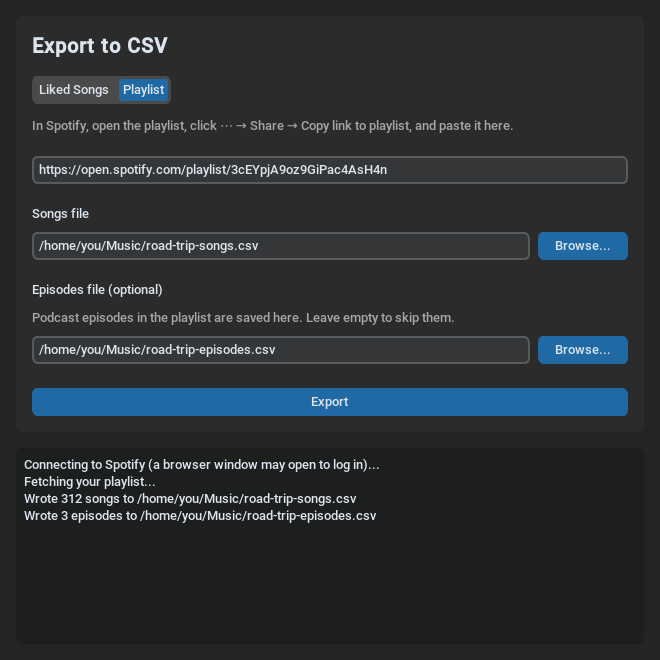
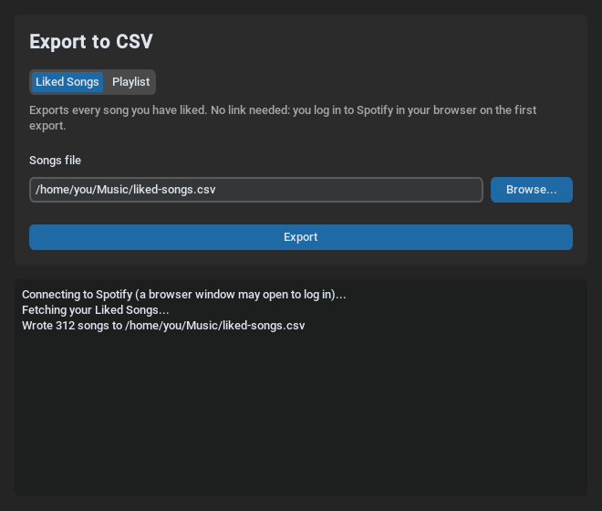

# Spotify Obtainer

Export your Spotify **Liked Songs** or **any playlist** to a CSV file, from a small window or from the command line.



- Works with your Liked Songs and with any playlist your account can open (your own, followed, private or collaborative).
- The CSV starts with readable columns: song, artists, album, date added, duration and link. The raw data follows after them.
- Podcast episodes in a playlist go to their own CSV file.
- It uses the official [Spotify Web API](https://developer.spotify.com/documentation/web-api) through [spotipy](https://spotipy.readthedocs.io/).

> **Note:** this exports **metadata only** (titles, artists, albums, links, ...). It does **not** download audio. The Spotify API does not provide audio, and downloading streams would break Spotify's Terms of Service.

## Contents

- [Quick start](#quick-start)
- [Setup](#setup)
  - [1. Requirements](#1-requirements)
  - [2. Create a Spotify app](#2-create-a-spotify-app)
  - [3. Create the `.env` file](#3-create-the-env-file)
  - [4. First run and login](#4-first-run-and-login)
- [Usage](#usage)
  - [Window (graphical interface)](#window-graphical-interface)
  - [Command line](#command-line)
- [Output: what is in the CSV](#output-what-is-in-the-csv)
- [Troubleshooting](#troubleshooting)
- [Limitations](#limitations)
- [Project files](#project-files)
- [License](#license)

## Quick start

If you have done this before, these are all the steps:

```sh
git clone https://github.com/mrkuko/SpotifyObtainer.git
cd SpotifyObtainer
cp .env.example .env                 # then fill in your Spotify app values
python spotifyObtainer.py --ui       # window
python spotifyObtainer.py > songs.csv   # or: command line, Liked Songs
```

If any of this is new, follow the setup below.

## Setup

### 1. Requirements

- **Python 3.11 or newer**: check with `python --version`.
- **A Spotify account.** A free account is fine.
- **tkinter**, only for the window. It comes with Python on Windows and macOS and with most Linux distributions. If it is missing, see [Troubleshooting](#troubleshooting).

You do not need to install any packages yourself. The first run creates a `venv` folder and installs everything from [requirements.txt](requirements.txt).

### 2. Create a Spotify app

Spotify only lets programs read your library through an "app" that you register. It's free and takes two minutes:

1. Open the [Spotify Developer Dashboard](https://developer.spotify.com/dashboard) and log in.
2. Click **Create app**.
3. Fill in any name and description. When asked which APIs you use, select **Web API**.
4. Under **Redirect URIs**, add:
   ```
   http://127.0.0.1:8888/callback
   ```
   Use `127.0.0.1`, **not** `localhost`. Since Spotify's [2025 security update](https://developer.spotify.com/blog/2025-02-12-increasing-the-security-requirements-for-integrating-with-spotify), `localhost` is rejected. Any free port works instead of `8888`, as long as you use the same one in `.env`.
5. Save. Open the app's **Settings**, where you find the **Client ID** and, under **View client secret**, the **Client secret**.

New apps start in **Development mode**. That's fine for personal use: you (the app owner) can log in. To let someone else use your app, add their Spotify account under **User Management**.

### 3. Create the `.env` file

The program reads your app's details from a file named `.env` in the project folder, next to `spotifyObtainer.py`. Copy the template and fill it in:

```sh
cp .env.example .env
```

```sh
SPOTIPY_CLIENT_ID=your_client_id_here
SPOTIPY_CLIENT_SECRET=your_client_secret_here
SPOTIPY_REDIRECT_URI=http://127.0.0.1:8888/callback
```

| Variable | Where to find it |
|---|---|
| `SPOTIPY_CLIENT_ID` | App settings → **Client ID** |
| `SPOTIPY_CLIENT_SECRET` | App settings → **View client secret** |
| `SPOTIPY_REDIRECT_URI` | Must be **exactly** one of the app's **Redirect URIs**: same `http`, same `127.0.0.1`, same port, same `/callback` |

> **Keep `.env` private.** It contains your client secret. It is listed in `.gitignore`, so git will not commit it. Don't share it or post screenshots of it.

### 4. First run and login

On the first run, the program:

1. creates the `venv` folder and installs the dependencies (this takes a moment, and output goes to the terminal),
2. opens your **web browser** with a Spotify login page; you approve access to your library, and the browser shows a short confirmation,
3. saves the login in a `.cache` file next to the script, so later runs don't ask again.

`.cache` holds your login token. Treat it like a password. It is ignored by git, and deleting it simply means you log in again.

## Usage

### Window (graphical interface)

```sh
python spotifyObtainer.py --ui
```

**Liked Songs:** pick where to save the file and click **Export**. No link needed.



**Playlist:** switch to **Playlist** and paste the playlist link. To get the link in Spotify, open the playlist, click **⋯ → Share → Copy link to playlist**. Choose the songs file and, if the playlist has podcast episodes, optionally an episodes file. If you leave the episodes file empty, episodes are skipped.


Some details:

- **Browse...** opens your desktop's own save dialog. On Linux it uses `kdialog` (KDE) or `zenity` if one of them is installed; otherwise it falls back to a simpler built-in dialog. On KDE, install `kdialog` to get the native KDE dialog.
- Text fields support **Ctrl+A / Ctrl+C / Ctrl+V / Ctrl+X** and a **right-click menu**. You can select and copy the log too.
- If you paste the link of your Liked Songs page (`open.spotify.com/collection/tracks`) into the playlist field, the window switches to Liked Songs.

### Command line

The CSV is printed to the terminal (stdout). Use `>` to save it to a file. Messages and errors go to stderr, so they never end up in the file.

| What | Command |
|---|---|
| Liked Songs | `python spotifyObtainer.py > liked-songs.csv` |
| A playlist | `python spotifyObtainer.py https://open.spotify.com/playlist/<id> > playlist.csv` |
| Playlist, episodes to their own file | `python spotifyObtainer.py <link> --episodes-out episodes.csv > songs.csv` |
| Open the window | `python spotifyObtainer.py --ui` |
| Show the version | `python spotifyObtainer.py --version` |
| Show all options | `python spotifyObtainer.py --help` |

The playlist argument can be a link (`https://open.spotify.com/playlist/<id>`, with or without `?si=...`), a URI (`spotify:playlist:<id>`) or the bare 22-character id. Anything else, such as an album or track link, is rejected with a clear message and exit code `2`.

Without `--episodes-out`, podcast episodes in a playlist are skipped, and a note like `skipped 3 episodes` is printed. Liked Songs never contain episodes. The exit code is non-zero whenever the export fails.

<details>
<summary>Setting up the venv by hand (optional)</summary>

`spotifyObtainer.py` creates and updates `venv` automatically. It reinstalls only when `requirements.txt` changes. If you prefer to manage it yourself:

```sh
python -m venv venv
source venv/bin/activate            # Windows (PowerShell): .\venv\Scripts\Activate.ps1
pip install -r requirements.txt
python generator.py --help          # generator.py takes the same arguments
```

</details>

## Output: what is in the CSV

The files are `;`-separated and UTF-8. They open in LibreOffice Calc, Excel (choose `;` as the separator) or any text editor.

The **songs** file starts with the columns you usually want:

| Column | Example |
|---|---|
| `name` | `DEVOLUTION` |
| `artist_names` | `STARSET` (several artists: `A, B`) |
| `album_name` | `HORIZONS` |
| `added_at` | `2026-10-13T07:27:24Z` |
| `duration` | `5:09` |
| `url` | `https://open.spotify.com/track/...` |

Then come simple values (`explicit`, `popularity`, `track_number`, `duration_ms`, `id`, `uri`, ...), and at the end the raw data as JSON inside the cell (`album`, `artists`, `external_ids`, `external_urls`). `linked_from` and `restrictions` are only filled when Spotify sends them. `available_markets`, a list of about 180 countries per song, is left out.

The **episodes** file follows the same idea: `name`, `show_name`, `release_date`, `added_at`, `duration`, `url`, then details (`description`, `language`, ...) and raw JSON (`show`, `images`, ...).

## Troubleshooting

| You see | Cause | Fix |
|---|---|---|
| Browser page: `redirect_uri: Not matching configuration` | `SPOTIPY_REDIRECT_URI` in `.env` differs from the app's Redirect URIs, often `localhost` instead of `127.0.0.1` or a different port | Make both **exactly** the same, see [step 3](#3-create-the-env-file) |
| Browser page: `INVALID_CLIENT` | Wrong Client ID or secret in `.env` | Copy both again from the app settings |
| The wrong browser opens | The `BROWSER` environment variable overrides your desktop's default browser (Linux: check `/etc/environment`, `~/.profile`) | Remove or change `BROWSER`, then log out and back in. To test without it: `env -u BROWSER python spotifyObtainer.py --ui` |
| `error while loading shared libraries: libpython3.x.so` or pip fails with exit status 127 | The `venv` was made with a Python version that is no longer installed, for example after a system upgrade | Delete the folder (`rm -rf venv`) and run again. It is recreated automatically |
| `No module named 'tkinter'` / `_tkinter` with `--ui` | Your Python has no Tk support | Install it, for example `sudo apt install python3-tk` (Debian/Ubuntu) or `sudo dnf install python3-tkinter` (Fedora). On Arch it comes with `python` |
| `error: not a Spotify playlist id, URI or link` | An album, track or other link was given | Use a playlist link: **⋯ → Share → Copy link to playlist** |
| `404` for a playlist | The playlist is Spotify-owned (see [Limitations](#limitations)), or your account cannot open it | Use a playlist created by a user, or copy the songs into your own playlist |
| You want to log in with a different account | The login is cached in `.cache` | Delete `.cache` and run again |

## Limitations

- **Spotify-owned playlists cannot be read.** Since Spotify's [November 2024 Web API changes](https://developer.spotify.com/blog/2024-11-27-changes-to-the-web-api), apps created after that date (and apps in development mode) get a `404` for Spotify's editorial and algorithmic playlists, such as "Today's Top Hits", "Discover Weekly" or "Daily Mix". Playlists made by users work. As a workaround, copy the songs into a playlist of your own and export that.
- For the same reason, `preview_url` is always empty for new apps.
- **Local files** you added to Spotify are skipped, because Spotify sends no data for them.
- Requested permissions are read-only: `user-library-read`, `playlist-read-private` and `playlist-read-collaborative`.

## Project files

| File | What it does |
|---|---|
| [spotifyObtainer.py](spotifyObtainer.py) | Entry point. Creates and updates `venv`, then runs `generator.py` with your arguments |
| [generator.py](generator.py) | Talks to Spotify, writes the CSV, command-line options |
| [ui.py](ui.py) | The window (CustomTkinter) |
| [dialogs.py](dialogs.py) | Native save dialogs (`kdialog` / `zenity`, Tk fallback) |
| [textedit.py](textedit.py) | Ctrl+A, right-click menu and copy support for text fields |
| [.env.example](.env.example) | Template for your `.env` |
| [CHANGELOG.md](CHANGELOG.md) | What changed in each version |

## License

[GNU General Public License v3.0](LICENSE).
